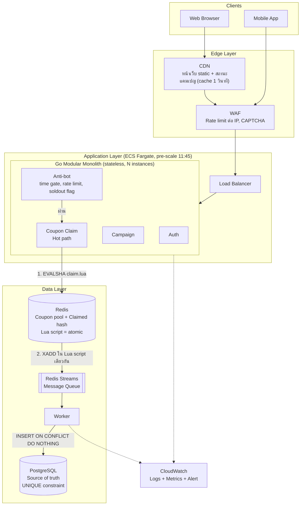
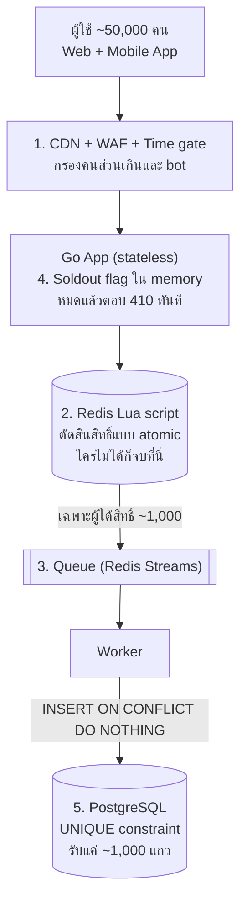
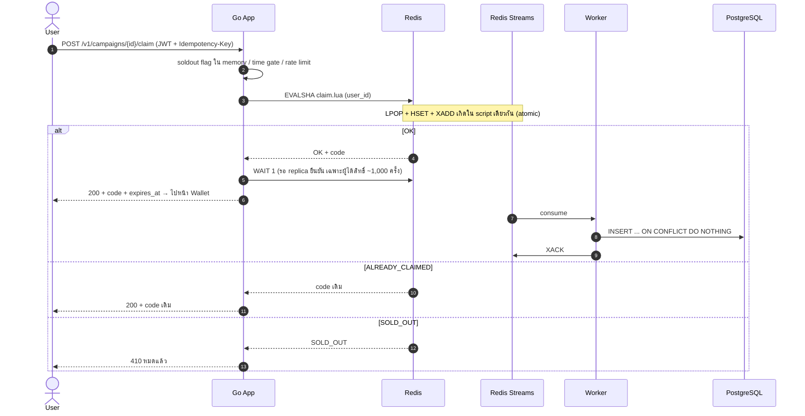

# Flash Sale Coupon System — Solution Design

> **สถานการณ์:** แจกโค้ดส่วนลด 1,000 สิทธิ์ เปิดกดพร้อมกันเวลา 12:00 น. คาดมีผู้ใช้ราว 50,000 คนเข้ามาพร้อมกันทั้ง Web และ Mobile App ภายใน 5 นาทีแรก
> **เป้าหมาย:** เสถียร · ขยายได้ง่าย · คุ้มค่า · ไม่ซับซ้อนเกินจำเป็น

---

## 0. ข้อสมมติฐาน

| หัวข้อ | ข้อตกลง |
|---|---|
| 1 คน | 1 บัญชีผู้ใช้ (ต้อง login) |
| วิธีแจก | Flash sale แบบใครกดได้ก่อนได้ก่อน ปุ่มกดได้ตั้งแต่ 12:00:00 ตามเวลา server |
| โค้ด | โค้ด unique ต่อคน สร้างไว้ล่วงหน้า 1,000 โค้ด มีวันหมดอายุ ถ้าไม่ใช้ถือว่าสละสิทธิ์ |
| เมื่อระบบขัดข้อง | หยุดแจกและแสดง error (Fail closed) |
| ความถี่ | จัดทุกเดือน |
| Cloud / ทีม | AWS Region ประเทศไทย (ap-southeast-7) · ทีมเล็ก → ใช้ Managed services |

**ประเมินโหลด:** traffic ไม่ได้กระจายตัวตลอด 5 นาที แต่จะพุ่งในช่วง **1–5 วินาทีแรก ประมาณ 10,000–15,000 req/s** ในขณะที่มีคำขอที่สำเร็จจริงแค่ **1,000 ครั้ง**
→ หัวใจของระบบคือ **ตัดสินผลให้เร็วที่ Redis และไม่ให้ traffic หลักไปถึง Database**

---

## ข้อ 1: High-Level System Architecture

### 1.1 Architecture Diagram



### 1.2 Tech Stack และเหตุผล

| Component | เลือกใช้ (AWS) | ทำไม |
|---|---|---|
| **CDN** | CloudFront | เสิร์ฟหน้าเว็บและสถานะ "หมดแล้ว" จาก edge ทำให้ server ไม่ต้องรับ traffic ส่วนนี้ |
| **WAF** | AWS WAF | Rate limit ต่อ IP + CAPTCHA กัน flood และ bot ตั้งแต่ขอบ |
| **Load Balancer** | ALB | กระจาย traffic ไปหลาย instance (ต้องประสานกับ AWS เรื่อง pre-warm ก่อนวันจริง) |
| **Application** | Go Modular Monolith บน **ECS Fargate** | Go รับ concurrency สูงได้ดี · stateless จึงขยายแนวนอนได้ · ใช้ Fargate ทำให้ไม่ต้องดูแล Kubernetes |
| **Cache / Gatekeeper** | ElastiCache (Redis/Valkey) primary + replica | ตัดสินสิทธิ์แบบ atomic ภายใน ~1 ms · ใช้ node แบบไม่ burstable เพราะ spike ตอน 12:00 |
| **Message Queue** | **Redis Streams** | เขียนจริงแค่ ~1,000 ครั้ง ไม่จำเป็นต้องใช้ Kafka และใช้ Redis ตัวเดิมได้ จึงไม่ต้องเพิ่ม infra · มี consumer group + ack รองรับการ retry |
| **Database** | RDS PostgreSQL (Multi-AZ) | Source of truth · มี UNIQUE constraint เป็นด่านสุดท้ายกันการแจกซ้ำ · โหลดต่ำเพราะ Redis กรองไว้แล้ว |
| **Logging / Monitoring** | CloudWatch | ใช้บริการของ AWS ที่มีอยู่แล้ว คุ้มค่าและดูแลง่าย จึงไม่ต้องเพิ่ม MongoDB |

### 1.3 ทำไมระบบไม่ล่ม

| เทคนิค | ผล |
|---|---|
| **Pre-scale** ด้วย scheduled scaling ตอน 11:45 (~10–12 tasks) | ไม่ต้องรอ auto-scaling ซึ่งตอบสนองช้ากว่า spike |
| **ตรวจแบบที่ใช้แค่ CPU ก่อน** (เวลาเปิด, soldout flag) แล้วจึงเรียก Redis | request ที่ยังไม่ถึงเวลาหรือมาหลังโค้ดหมด ถูกตอบโดยไม่ต้องใช้ Redis |
| **Soldout flag เก็บใน memory** ของทุก instance (แจ้งผ่าน Redis Pub/Sub) | โค้ดหมดภายในไม่กี่วินาที คำขอหลังจากนั้นจึงตอบ `410` ได้ทันทีโดยไม่ต้องเรียก Redis |
| **CDN cache สถานะแคมเปญ** 1 วินาที | คนที่เปิดหน้ามาภายหลังไม่ต้องยิงถึง server |
| **เขียน DB แบบ async** ผ่าน Queue | Database ไม่อยู่บน hot path |
| **Fail closed** — ถ้า Redis ล่ม ระบบตอบ `503` และหยุดแจก | ไม่ fallback ไปตัดสิทธิ์ที่ DB ซึ่งจะทำให้เกิด race condition และ DB ล่มตาม |
| **Load test** ด้วย k6 ที่ ~15,000 req/s ก่อนวันจริง | ได้ตัวเลขจริงสำหรับกำหนดขนาดเครื่อง |

#### ชั้นปกป้อง Database



| ลำดับ | ชั้น | ทำอะไร | ผลต่อ Database |
|---|---|---|---|
| 1 | CDN + WAF + Time gate | กรองคนส่วนเกินและ bot ออกก่อนถึง Redis | ไม่มี traffic ถึง DB |
| 2 | Redis Lua script | ตัดสินสิทธิ์แบบ atomic — ใครไม่ได้ก็จบที่ Redis | ไม่มี traffic ถึง DB |
| 3 | Queue + Worker | ส่งเฉพาะผู้ได้สิทธิ์ ~1,000 รายการไปเขียนแบบ async | DB รับแค่ ~1,000 แถว |
| 4 | Soldout flag ใน memory | หลังโค้ดหมด ตอบทันทีโดยไม่เรียก Redis และ DB | ไม่มี traffic ถึง DB |
| 5 | PostgreSQL UNIQUE constraint | ด่านสุดท้ายกันแจกซ้ำ ถ้า Redis หรือ Worker ผิดพลาด | Safety net |

**ผลลัพธ์:** จากคำขอหลายหมื่น มีแค่ **~1,000 แถว** ที่ไปถึง Database และเขียนแบบ async จึงไม่อยู่บน hot path

### 1.4 กัน Bot (แบบ Flash Sale)

ปุ่มกดจะ disabled พร้อมนับถอยหลังตาม**เวลาจาก server** และกดได้ตอน 12:00:00 ส่วน server จะตรวจซ้ำอีกชั้นเสมอ

| ชั้น | กฎ |
|---|---|
| Time gate | คำขอ **ก่อน 12:00:00** → ตอบ "ยังไม่เปิด" ให้กดใหม่ได้ (ไม่ block ทันที เพราะนาฬิกาเครื่องผู้ใช้อาจคลาดเคลื่อนเล็กน้อย) · block เฉพาะบัญชีที่ยิงก่อนเวลา **ซ้ำหลายครั้ง** หรือ **เร็วกว่าเวลาเปิดเกิน 2 วินาที** |
| สัญญาณต้องสงสัย | คำขอที่มาถึงใน **0–150 ms แรก** ไม่ถูกปฏิเสธ (คนจริงอาจกดทันทีได้) แต่ถูกบันทึกไว้ประกอบการตรวจย้อนหลัง |
| Rate limit ต่อ user | ส่งได้ไม่เกิน 1 request/วินาที (`SET NX PX 1000`) |
| บัญชีที่ยืนยันแล้ว | ต้องยืนยันเบอร์โทรด้วย OTP |
| ตรวจย้อนหลัง | หลังจบแคมเปญ ดูสัญญาณต้องสงสัย (เวลาตอบสนองเร็วผิดปกติ, หลายบัญชีจาก device/IP เดียวกัน) แล้วเปลี่ยนสถานะโค้ดเป็น `REVOKED` ก่อนถูกใช้ |

### 1.5 โครงสร้างโค้ด (Monolith First + Clean Architecture)

```
/cmd
  /api        -> HTTP server
  /worker     -> queue consumer (แยก binary เพื่อสเกลแยกจาก API)
/internal
  /auth
  /campaign
  /antibot
  /coupon     -> claim (hot path) — ถ้าต้องแยกเป็น microservice จะแยกตัวนี้ก่อน
    /domain  /usecase  /repository  /delivery
/pkg          -> logger, config, redis, mq
```
Module เรียกใช้กันผ่าน interface เท่านั้น จึงแยกออกเป็น service ได้ง่ายในอนาคต

---

## ข้อ 2: แก้ปัญหา Concurrency (Race Condition)

### 2.1 ปัญหา
ถ้าใช้ logic `SELECT count → if < 1000 → INSERT` ใน application มีโอกาสที่หลาย request จะอ่านค่าเดียวกันพร้อมกัน แล้วผ่านเงื่อนไขทั้งหมด ผลคือ **แจกเกิน 1,000 สิทธิ์** หรือ **คนเดียวได้ 2 สิทธิ์** (เช่น กดรัวหรือเปิด 2 เครื่อง)

### 2.2 แนวทาง: ให้ Redis Lua Script เป็นผู้ตัดสินแบบ Atomic

Redis รันคำสั่งแบบ single-thread และรัน Lua script ทั้งก้อนเป็น atomic operation จึง**ไม่มีช่องว่างระหว่าง "เช็ก" กับ "ตัดสิทธิ์"**

**เตรียมก่อนเปิดแคมเปญ (11:30):** สร้างโค้ด 1,000 โค้ดใน PostgreSQL แล้วโหลดเข้า Redis List

| Redis Key | Type | หน้าที่ |
|---|---|---|
| `campaign:{id}:pool` | List | โค้ดที่ยังไม่ถูกแจก (1,000 ตัว) |
| `campaign:{id}:claimed` | Hash | `user_id → coupon_code` สำหรับกัน 1 คนได้หลายสิทธิ์ |
| `campaign:{id}:blocked` | Set | บัญชีที่ถูก block จากระบบกัน bot |
| `campaign:{id}:soldout` | String | flag ว่าโค้ดหมดแล้ว |
| `campaign:{id}:events` | Stream | Queue ของผู้ได้สิทธิ์ ให้ Worker นำไปบันทึกลง PostgreSQL |

```lua
-- claim.lua
-- KEYS[1]=pool  KEYS[2]=claimed  KEYS[3]=soldout  KEYS[4]=blocked  KEYS[5]=events
-- ARGV[1]=user_id  ARGV[2]=claimed_at
if redis.call('SISMEMBER', KEYS[4], ARGV[1]) == 1 then
  return {'BLOCKED', ''}
end

local existing = redis.call('HGET', KEYS[2], ARGV[1])
if existing then
  return {'ALREADY_CLAIMED', existing}   -- คืนโค้ดเดิม ไม่ได้ซ้ำ
end

local code = redis.call('LPOP', KEYS[1])
if not code then
  redis.call('SET', KEYS[3], '1')
  return {'SOLD_OUT', ''}                -- หมดแล้ว ไม่มีทางเกิน 1,000
end

redis.call('HSET', KEYS[2], ARGV[1], code)
-- ส่ง event เข้า Queue (Redis Streams) ใน script เดียวกัน → atomic กับการตัดสิทธิ์
redis.call('XADD', KEYS[5], '*', 'user_id', ARGV[1], 'code', code, 'claimed_at', ARGV[2])
return {'OK', code}
```

**ทำไมถึงแจกไม่เกิน 1,000 แน่นอน:** List มีโค้ดอยู่แค่ 1,000 ตัว และ `LPOP` ดึงออกทีละตัวแบบ atomic เมื่อหมดก็ได้ค่า `nil` ทันที ไม่ต้องอาศัยตัวนับ
**ทำไมคนเดียวไม่ได้ซ้ำ:** `HGET` และ `HSET` อยู่ใน script เดียวกัน ถ้า request ที่สองของคนเดิมเข้ามา ก็จะเจอโค้ดที่ได้ไปแล้วเสมอ
**ทำไม event ไม่หาย:** การตัดสิทธิ์ (`LPOP` + `HSET`) และการส่งเข้า Queue (`XADD`) อยู่ใน Lua script เดียวกัน จึงสำเร็จพร้อมกันหรือไม่เกิดขึ้นเลย ถ้า App ล่มหลังเรียก script ก็ไม่มีสถานะที่ตัดสิทธิ์แล้วแต่ไม่มี event ให้ Worker
> ถ้าใช้ Redis Cluster ให้ตั้งชื่อ key ด้วย hash tag เช่น `campaign:{123}:pool` เพื่อให้ทุก key ของแคมเปญอยู่ใน slot เดียวกัน script จึงทำงานได้

### 2.3 Flow การกดรับ



### 2.4 ด่านสุดท้ายที่ PostgreSQL

```sql
CREATE TABLE coupon_claims (
  id           BIGSERIAL PRIMARY KEY,
  campaign_id  BIGINT      NOT NULL,
  user_id      BIGINT      NOT NULL,
  coupon_code  VARCHAR(32) NOT NULL,
  claimed_at   TIMESTAMPTZ NOT NULL,
  expires_at   TIMESTAMPTZ NOT NULL,
  status       VARCHAR(16) NOT NULL DEFAULT 'CLAIMED', -- CLAIMED | USED | REVOKED
  UNIQUE (campaign_id, user_id),   -- 1 บัญชี 1 สิทธิ์
  UNIQUE (coupon_code)             -- 1 โค้ด 1 เจ้าของ
);

-- Worker: idempotent จึง retry ซ้ำกี่ครั้งก็ไม่เกิดข้อมูลซ้ำ
INSERT INTO coupon_claims (campaign_id, user_id, coupon_code, claimed_at, expires_at)
VALUES ($1, $2, $3, $4, $5)
ON CONFLICT DO NOTHING;
```

### 2.5 เมื่อข้อมูลระหว่าง Redis, Queue และ Database ไม่ตรงกัน

| เหตุการณ์ | ผลที่เกิด | การรับมือ |
|---|---|---|
| App ล่มหลังเรียก Lua script | ไม่เกิดสถานะค้าง | `XADD` อยู่ใน script เดียวกับการตัดสิทธิ์ ถ้าตัดสิทธิ์สำเร็จ event ก็อยู่ใน Queue แล้ว ผู้ใช้ที่ไม่ได้รับคำตอบกดใหม่จะได้ `ALREADY_CLAIMED` พร้อมโค้ดเดิม |
| Worker ล่ม | event ค้างใน Queue | ข้อความที่ยังไม่ `XACK` อยู่ใน Pending List แล้ว Worker ตัวอื่นดึงไปทำต่อด้วย `XAUTOCLAIM` · ล้มเหลวเกิน 5 ครั้งย้ายไป DLQ และส่ง alert |
| DB ยังไม่ครบ | Redis กับ PostgreSQL ไม่ตรงกันชั่วคราว | Reconciliation เทียบ `claimed` ใน Redis กับ PostgreSQL ทุก 1 นาที แล้ว insert ส่วนที่ขาด (idempotent) |
| Redis primary ล่ม แล้ว replica ยังไม่ได้ข้อมูลล่าสุด | สิทธิ์ที่แจกไปแล้วอาจหายจาก Redis และโค้ดกลับเข้า pool | **ป้องกัน:** เรียก `WAIT 1` ก่อนตอบผู้ได้สิทธิ์ ให้ replica ยืนยันว่าได้ข้อมูลแล้ว + เปิด AOF · **ถ้ายังเกิด:** `UNIQUE(coupon_code)` ใน PostgreSQL จับโค้ดที่ถูกแจกซ้ำ → Worker ส่ง alert ให้ทีมแก้ทีละกรณี โดยยึดเจ้าของที่บันทึกใน PostgreSQL ก่อน |
| Redis ล่มกลางแคมเปญ | — | **Fail closed:** หยุดแจกทันที · ก่อนเปิดแจกต่อ ต้องรัน Reconciliation ให้ `pool + claimed = 1,000` และตรงกับ PostgreSQL |

ห้ามลบ key ของแคมเปญใน Redis จนกว่าจะยืนยันว่า PostgreSQL มีครบ

### 2.6 สรุปชั้นป้องกัน

| ชั้น | ป้องกันอะไร |
|---|---|
| ปุ่ม disable หลังกด (client) | กดรัวโดยไม่ตั้งใจ — เป็นแค่ UX |
| Idempotency-Key | client retry ซ้ำเมื่อเน็ตหลุด |
| Time gate + Rate limit | bot และการยิงก่อนเวลา |
| **Redis Lua (atomic)** | **Race condition · แจกเกิน 1,000 · 1 คนได้ 2 สิทธิ์** |
| PostgreSQL UNIQUE | Safety net กรณี Redis หรือ Worker ผิดพลาด |
| Reconciliation | ยืนยันว่าข้อมูลใน Redis และ PostgreSQL ตรงกัน |

---

## สรุป

1. **Architecture:** CDN + WAF → ALB → Go Modular Monolith (ECS Fargate, pre-scale) → Redis (gatekeeper + queue) → Worker → PostgreSQL โดยใช้ Managed services ทั้งหมด จึงคุ้มค่าและดูแลง่าย
2. **Concurrency:** ใช้ **Redis Lua script** ตัดสินสิทธิ์แบบ atomic จาก pool โค้ด 1,000 ตัว ทำให้ไม่มี race condition ไม่แจกเกิน และไม่ซ้ำ โดยมี **PostgreSQL UNIQUE constraint** เป็นด่านสุดท้าย
