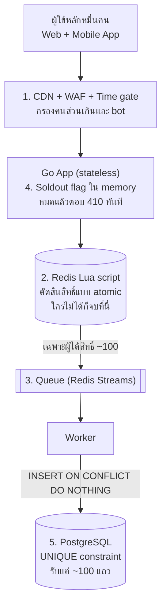

# สถานการณ์ที่ 3 — แจกคูปอง 100 สิทธิ์ ผู้ใช้หลักหมื่นคน

> **โจทย์:** บริษัทจัดแคมเปญแจกคูปอง 100 สิทธิ์ ผู้ใช้หลักหมื่นคนกดเข้ามาพร้อมกันตอน 12:00 น.
> จะออกแบบ Architecture และ Logic อย่างไร **ไม่ให้ Database ล่ม** และ **ป้องกันการแจกเกิน (Overbooking)**

ใช้ Architecture เดียวกับสถานการณ์ที่ 1 (`scenario-1.md`) และปรับขนาดตามโหลดที่น้อยลง ไฟล์นี้เน้นเฉพาะประเด็นที่โจทย์ถาม คือ **การปกป้อง Database** และ **การกัน Overbooking**

---

## 1. เทียบกับสถานการณ์ที่ 1

| หัวข้อ | สถานการณ์ที่ 1 | สถานการณ์ที่ 3 | หมายเหตุ |
|---|---|---|---|
| จุดเน้นของคำถาม | Tech stack + แก้ Race Condition | ไม่ให้ Database ล่ม + กัน Overbooking | สถานการณ์ที่ 3 ควรเล่าจากมุมของ Database |
| จำนวนสิทธิ์ | 1,000 | 100 | สิทธิ์น้อยลง → โค้ดหมดเร็วขึ้น |
| ผู้ใช้ | ~50,000 | หลักหมื่น | |
| Peak | ~10–15k req/s | ~3–5k req/s | ประมาณจากสัดส่วน ต้องยืนยันด้วย load test |
| ขนาดเครื่อง | ~10–12 tasks | น้อยกว่าสถานการณ์ที่ 1 | ยืนยันด้วย load test |
| จำนวนแถวที่เขียนลง DB | 1,000 | 100 | เขียนแบบ async ผ่าน Queue |
| เวลาที่โค้ดหมด | ไม่กี่วินาที | อาจไม่ถึง 1 วินาที | Soldout flag ใน memory ยิ่งสำคัญ เพราะคำขอเกือบทั้งหมดเข้ามาหลังโค้ดหมด |

---

## 2. Architecture: กรอง traffic ทีละชั้นก่อนถึง Database



### ชั้นปกป้อง Database

| ลำดับ | ชั้น | ทำอะไร | ผลต่อ Database |
|---|---|---|---|
| 1 | CDN + WAF + Time gate | กรองคนหลักหมื่นและ bot ออกก่อนถึง Redis | ไม่มี traffic ถึง DB |
| 2 | Redis Lua script | ตัดสินสิทธิ์แบบ atomic — ใครไม่ได้ก็จบที่ Redis | ไม่มี traffic ถึง DB |
| 3 | Queue + Worker | ส่งเฉพาะผู้ได้สิทธิ์ ~100 รายการไปเขียนแบบ async | DB รับแค่ ~100 แถว |
| 4 | Soldout flag ใน memory | หลังโค้ดหมด ตอบทันทีโดยไม่เรียก Redis และ DB | ไม่มี traffic ถึง DB |
| 5 | PostgreSQL UNIQUE constraint | ด่านสุดท้ายกันแจกซ้ำ ถ้า Redis หรือ Worker ผิดพลาด | Safety net |

**ผลลัพธ์:** จากคำขอหลักหมื่น มีแค่ **~100 แถว** ที่ไปถึง Database และเขียนแบบ async จึงไม่อยู่บน hot path

---

## 3. ทำไมไม่ล็อกที่ Database

| วิธี | กันแจกเกินได้ | ภาระต่อ DB | ปัญหาเมื่อคนหลักหมื่นยิงพร้อมกัน | เลือกใช้ |
|---|:---:|---|---|:---:|
| `SELECT count` แล้ว `INSERT` | ❌ | ทุกคำขอถึง DB | เกิด race condition จึงแจกเกิน (overbooking) | |
| `SELECT ... FOR UPDATE` | ✅ | ทุกคำขอถึง DB และรอ lock | ทุกคำขอรอ lock แถวเดียวกัน connection pool เต็ม แล้ว DB ล่ม | |
| `UPDATE stock SET n = n-1 WHERE n > 0` | ✅ | ทุกคำขอถึง DB | กันแจกเกินได้ แต่ทุกคำขอแย่งกันแก้แถวเดียว (hot row) | |
| **Redis Lua + Queue** | ✅ | เขียนแค่ 100 แถว | ตัดสินใน memory แบบ atomic — DB รับแค่ผลลัพธ์ | ✅ |

---

## 4. Logic กัน Overbooking

**เตรียมก่อนเปิด:** สร้างโค้ด 100 โค้ดใน PostgreSQL แล้วโหลดเข้า Redis List `campaign:{id}:pool`

```lua
-- claim.lua  (KEYS[1]=pool  KEYS[2]=claimed  KEYS[3]=soldout  KEYS[4]=events   ARGV[1]=user_id)
local existing = redis.call('HGET', KEYS[2], ARGV[1])
if existing then return {'ALREADY_CLAIMED', existing} end

local code = redis.call('LPOP', KEYS[1])
if not code then
  redis.call('SET', KEYS[3], '1')
  return {'SOLD_OUT', ''}
end

redis.call('HSET', KEYS[2], ARGV[1], code)
redis.call('XADD', KEYS[4], '*', 'user_id', ARGV[1], 'code', code)  -- ส่งเข้า Queue ใน script เดียวกัน
return {'OK', code}
```

- **ไม่แจกเกิน 100:** List มีโค้ดแค่ 100 ตัว `LPOP` ดึงออกทีละตัวแบบ atomic เมื่อหมดก็ได้ `nil` ทันที
- **1 บัญชีไม่ได้ซ้ำ:** `HGET` และ `HSET` อยู่ใน script เดียวกัน คำขอที่สองของคนเดิมจะเจอโค้ดที่ได้ไปแล้ว
- **Event ไม่หาย:** การตัดสิทธิ์และการ `XADD` เข้า Queue อยู่ใน script เดียวกัน ถ้า App ล่มหลังเรียก script ก็ไม่มีสถานะที่ตัดสิทธิ์แล้วแต่ไม่มี event
- **ด่านสุดท้ายใน PostgreSQL:**

```sql
UNIQUE (campaign_id, user_id)   -- 1 บัญชี 1 สิทธิ์
UNIQUE (coupon_code)            -- 1 โค้ด 1 เจ้าของ

INSERT INTO coupon_claims (...) VALUES (...) ON CONFLICT DO NOTHING;  -- idempotent
```

---

## 5. ถ้าระบบขัดข้อง

| เหตุการณ์ | การรับมือ |
|---|---|
| Redis ล่ม | **Fail closed:** หยุดแจกและตอบ `503` — ห้าม fallback ไปตัดสิทธิ์ที่ DB เพราะจะเกิด race condition และ DB ล่มตาม |
| App ล่มหลังตัดสิทธิ์ | ไม่เกิดสถานะค้าง เพราะ `XADD` อยู่ใน Lua script เดียวกัน |
| Worker ล่ม | ข้อความค้างใน Queue แล้ว Worker ตัวอื่นดึงไปทำต่อ (`XAUTOCLAIM`) + Reconciliation เทียบ Redis กับ DB |
| Redis failover แล้วข้อมูลล่าสุดหาย | ป้องกันด้วย `WAIT 1` ก่อนตอบผู้ได้สิทธิ์ · ถ้ายังเกิด `UNIQUE(coupon_code)` จับโค้ดที่ถูกแจกซ้ำและส่ง alert · ก่อนเปิดแจกต่อต้อง Reconcile ให้ตรงกัน |

---

## สรุป

1. **ไม่ให้ Database ล่ม:** กรองคำขอทีละชั้น (CDN/WAF → Time gate → Soldout flag → Redis) และเขียน DB แบบ async ผ่าน Queue ทำให้ DB รับแค่ ~100 แถว
2. **กัน Overbooking:** ใช้ Redis Lua script ดึงโค้ดจาก pool 100 ตัวแบบ atomic และมี PostgreSQL UNIQUE constraint เป็นด่านสุดท้าย
